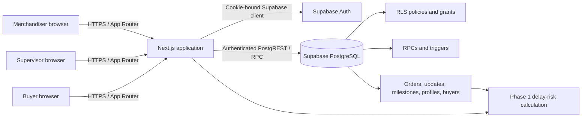

# KnitTrack

## Technical Design Document

**Project:** KnitTrack production order tracking  
**Repository:** [github.com/PremPandey9/KnitTrack](https://github.com/PremPandey9/KnitTrack)  
**Document date:** November 9, 2026  
**Status:** Design description of the current repository implementation

---

## 1. Project overview and problem statement

KnitTrack is a web application for knitwear exporters to coordinate purchase orders, factory production progress, delivery milestones, and buyer visibility. Export production can involve several work stages and several organizations. Without a shared record, teams can have difficulty seeing which orders are active, how much finished output is available, what milestones are due, and what information a buyer is permitted to see.

KnitTrack provides a role-aware application backed by Supabase. Merchandisers manage orders and follow production, supervisors report daily work for assigned orders, and buyers view progress for their own company. The system preserves daily stage-throughput history separately from the order's finished-goods quantity.

## 2. Objectives and scope

### Objectives

- Keep production order and update data in a shared Supabase database.
- Make merchandiser, supervisor, and buyer workflows available through one Next.js application.
- Enforce access with authenticated server code and database Row Level Security (RLS).
- Preserve daily production history while maintaining an order-level finished-goods total.
- Give buyers read-only visibility into their own orders, progress, history, and TNA milestones.
- Calculate transparent delay-risk indicators for merchandisers from finished-stage history.

### In scope

- Email/password authentication and profile-based roles.
- Purchase order creation and supervisor assignment.
- Daily production update entry and history.
- TNA milestone management and buyer display.
- Buyer-specific read-only dashboard.
- Phase 1 delay-risk calculation for merchandisers.
- Supabase baseline migrations and synthetic staging seed instructions.

### Out of scope or not currently implemented

- Production photo upload (Storage is not configured; photo URL is stored as an empty string by the current database trigger).
- Tamil AI classification.
- Offline update queueing.
- Deployed Delay Alerts Phase 2 approval and buyer notification workflow. The Phase 2 SQL is a proposal and the feature flag must remain disabled.

## 3. Technology stack and architecture

| Layer | Technology | Responsibility |
| --- | --- | --- |
| Web framework | Next.js 16 App Router | Server-rendered routes, layouts, loading boundaries, and server actions |
| Language | TypeScript | Typed application code and server/client boundaries |
| UI | React 19, Tailwind CSS 4 | Interactive forms and responsive dashboard components |
| Authentication | Supabase Auth, `@supabase/ssr` | Email/password sign-in and cookie-backed sessions |
| Data access | `@supabase/supabase-js` | Authenticated database reads, writes, and RPC calls |
| Database | Supabase PostgreSQL | Relational data, constraints, functions, triggers, grants, and RLS |
| Validation | Node test runner, ESLint, TypeScript compiler | Unit/integration checks, linting, and type validation |

The browser receives only the Supabase project URL and publishable/legacy anon key. The application does not use a service-role key. Server components and actions create a cookie-bound Supabase client so database requests carry the signed-in user's session and remain subject to RLS.

## 4. System architecture



The Next.js application chooses pages and actions based on the verified profile role. PostgreSQL independently restricts rows and write paths. The production update RPC and database triggers validate update attribution and maintain order progress atomically. Delay-risk calculation runs on server-fetched data and does not write production quantities.

## 5. Application modules and responsibilities

| Module | Primary responsibility |
| --- | --- |
| `src/app/sign-in` and `src/app/actions/auth.ts` | Email/password sign-in, profile validation, role landing redirects, and sign-out |
| `src/lib/supabase/server.ts` | Cookie-bound Supabase server client used by server components/actions |
| `src/lib/supabase/client.ts` | Browser Supabase client for permitted browser-side use |
| `src/lib/supabase/auth.ts` | Auth user verification, profile loading, role validation, and `requireRole` guards |
| `proxy.ts` | Session refresh and supervisor navigation redirect handling |
| `src/app/page.tsx`, `src/lib/supabase/orders.ts` | Merchandiser dashboard data, actual order metrics, buyer names, and delay calculations |
| `src/app/orders`, `src/lib/supabase/orders-page.ts` | Orders route and order list filtering/presentation data |
| `src/app/actions/orders.ts` | Merchandiser-only order creation, supervisor assignment, and final-stage configuration action |
| `src/app/production-tracking`, `src/lib/supabase/production.ts` | Production orders, history, available supervisor list, and role-scoped data |
| `src/app/actions/production.ts` | Validates and submits daily updates through `submit_production_update` RPC |
| `src/app/buyer-dashboard`, `src/lib/supabase/buyer-portal.ts` | Buyer-scoped company, orders, updates, and milestones |
| `src/lib/delay-risk.ts` | Pure Phase 1 delay-risk calculation and status tone mapping |
| `src/components/dashboard` | Dashboard, order, production tracking, buyer portal, forms, navigation, and status presentation |
| `supabase/migrations` | Baseline relational schema and database security/progress logic |
| `supabase/seed/staging_demo.sql` | One-time synthetic staging data seed; requires pre-created Supabase Auth identities and `psql` |

## 6. User roles and permissions

| Role | Allowed capabilities | Restrictions |
| --- | --- | --- |
| Merchandiser | View/manage orders, create orders, assign/unassign supervisors, configure final stage before finished output exists, manage TNA milestones, review production history, and inspect delay-risk results | Cannot directly update order progress fields; progress changes through the protected production RPC/trigger path |
| Supervisor | View assigned orders and their associated production history; submit daily production updates with notes | Cannot view unassigned production orders, change buyer/order ownership, assign themselves, manage buyer records, or approve delay alerts |
| Buyer | Read own company profile, orders, production updates, and TNA milestones | Cannot create, update, assign, or delete production records; cannot see another buyer's data or unapproved Phase 2 alerts |

The role is loaded from `profiles` after `auth.getUser()` verifies the Supabase Auth identity. A buyer profile without a buyer assignment is rejected. UI visibility is supplementary: route guards, server actions, database grants, and RLS policies provide enforcement.

## 7. Database schema and relationships

The baseline is designed for a new Supabase project. It creates five application tables. UUID identity fields use PostgreSQL UUIDs; date fields are SQL `date`; event timestamps use `timestamptz`.

| Table | Important columns | Purpose and constraints |
| --- | --- | --- |
| `buyers` | `id`, `company_name`, `country`, `contact_email`, `created_at` | Buyer company records; nonblank company name |
| `profiles` | `id`, `full_name`, `role`, `buyer_id`, `created_at` | One application profile per `auth.users` identity; roles are merchandiser, supervisor, buyer; buyer role requires a buyer link |
| `orders` | `id`, `po_number`, `buyer_id`, `style_name`, `colour`, `total_quantity`, `completed_quantity`, `current_stage`, `ex_factory_date`, `assigned_supervisor_id`, `final_production_stage`, `created_at` | Purchase order; unique PO number; positive total, completed quantity between zero and total; stage values constrained; final stage defaults to Finishing and remains nullable for legacy/unconfigured orders |
| `production_updates` | `id`, `order_id`, `stage`, `quantity_completed`, `issue_note`, `photo_url`, `update_date`, `supervisor_id`, `created_at` | Daily throughput event at a stage; positive integer quantity; issue note limited to 2,000 characters; photo URL currently empty |
| `tna_milestones` | `id`, `order_id`, `milestone_name`, `planned_date`, `actual_date`, `status`, `created_at` | Time and action milestone associated with an order |

Relationships:

- One buyer has many orders; each order references one buyer.
- A buyer profile references its buyer company; merchandiser and supervisor profiles have no buyer assignment.
- Profiles and supervisor assignment refer to Supabase Auth UUIDs.
- One order has many production updates and many TNA milestones.
- An update's `supervisor_id` records the supervisor actor; merchandiser-originated updates use NULL.
- Foreign-key deletion rules protect history: orders referenced by production updates or milestones cannot be deleted (`ON DELETE RESTRICT`). Buyer rows referenced by profiles/orders are similarly protected. Removing an Auth identity cascades its profile and nulls supervisor references where configured.

Indexes support role/profile lookups, buyer and supervisor order lists, ex-factory dates, order update history, and planned milestone sorting.

## 8. Authentication and Row Level Security

1. The sign-in server action calls Supabase `signInWithPassword` using the cookie-bound server client.
2. It looks up `profiles` by the authenticated Auth UUID, rejects missing/invalid roles and invalid buyer profiles, then redirects to the role's home route.
3. Shared `requireProfile` and `requireRole` helpers verify the current Auth user and load trusted profile data for protected pages/actions.
4. The session refresh proxy propagates updated cookies. Supervisors are directed to production tracking when opening excluded navigation routes.
5. RLS is enabled on all five public application tables. Policies scope buyers to their own company, supervisors to assigned orders, and merchandisers to management data.
6. Table grants are column-scoped where necessary. Authenticated users cannot directly write `orders.completed_quantity` or `orders.current_stage`; the database trigger updates those values as part of an authorized production update.
7. `submit_production_update` is a `SECURITY INVOKER` RPC. It checks the actor role, stage, positive whole quantity, update date, note length, order access, and supervisor assignment. A row-locking validation trigger and progress trigger keep history insertion and order progress in one transaction.
8. `configure_order_final_stage` is a narrow `SECURITY DEFINER` function that validates `auth.uid()` and merchandiser role, locks the order, and refuses a changed final stage after completed quantity is positive. The function uses a pinned search path and is executable by authenticated users; its internal role check is authoritative.

The core security migration also defines `current_user_role()` and `current_user_buyer_id()` helpers with pinned search paths and restricted execution grants. Deployment guidance requires migration execution as the trusted Supabase `postgres` owner and verification on the hosted project; the disposable test fixture is not a substitute for hosted verification.

## 9. Main workflows

### 9.1 Order creation

1. The merchandiser opens the create-order form. Buyer options are fetched from `buyers` and display `company_name` while retaining the buyer UUID.
2. The server action requires the merchandiser role and validates required text, existing buyer UUID, unique PO number, positive whole quantity, valid ex-factory date, and supported initial/final stage values.
3. It inserts the order through the authenticated Supabase server client. The database's unique and check constraints remain the final validation boundary.
4. Final stage defaults to Finishing. The form allows a merchandiser to choose a supported stage.
5. The server revalidates the dashboard and orders paths. Optional TNA milestones are not part of the current order insert transaction unless separately created through the milestone workflow.

### 9.2 Production updates

1. Merchandisers can select accessible orders; supervisors receive only orders assigned to their Auth UUID.
2. The user submits order, stage, daily quantity, date, and optional issue note. Photo attachment is visibly unavailable until Storage is configured.
3. The server action validates inputs and, for supervisors, checks the selected order assignment before calling the RPC.
4. The RPC records a production update. Daily `quantity_completed` is stage throughput, not a cumulative total.
5. A database trigger updates `orders.current_stage` and increments `orders.completed_quantity` only when the update stage matches the configured final production stage. Intermediate-stage work is retained in history without adding to finished goods.
6. Row locking plus database constraints protect the final quantity from exceeding the order total. The server revalidates production tracking, dashboard, and order views after success.

### 9.3 Buyer portal

1. A buyer signs in and is redirected to `/buyer-dashboard`.
2. Server code requires the buyer role and derives the buyer UUID from the authenticated user's profile; it does not trust a browser-provided buyer ID.
3. The portal loads the company name, orders, production updates, and TNA milestones through the cookie-bound Supabase client. Queries are additionally constrained by RLS.
4. The buyer sees order quantity/progress, stage, ex-factory/final stage, daily update history and notes, valid photo URLs if any, and milestone planned/actual dates and status.
5. The portal is read-only. Invalid buyer profile assignment prevents dashboard access.

### 9.4 Phase 1 delay-risk calculation

The pure `calculateDelayRisk()` function uses the order's total and completed finished-goods quantities, final stage, ex-factory date, and production update history. It is shown to merchandisers in the dashboard and order-related views; buyer notification/approval is not implemented.

- Remaining quantity is `max(0, total_quantity - completed_quantity)`.
- The observation window is 14 calendar days in `Asia/Kolkata`, including weekends; future-dated updates are ignored.
- Only updates whose trimmed, case-insensitive stage matches `final_production_stage` count. Multiple entries on the same date are summed.
- Observed daily output is total eligible output divided by 14. Required daily output is remaining quantity divided by available calendar days; due date is included as a production day.
- At least five distinct output dates spanning seven calendar days are required for pace classification.
- Complete: no remaining quantity. Overdue: past due date with remaining quantity. Pace ratio below 0.80 is High Risk; 0.80 to below 1.00 is At Risk; 1.00 to below 1.10 is Watch; at least 1.10 is On Track. Insufficient or invalid data is Review Needed.
- A NULL final stage is Review Needed. Existing final stage changes after quantity has been counted are rejected by the configuration RPC; historical rates are never used to reset or rewrite finished quantity.

Phase 2 signed candidate recording and approval is not enabled or deployed. Buyers do not receive these Phase 1 calculations as approved alerts.

## 10. Testing and validation

The repository defines these application checks:

```bash
npm test
npm run test:delay-risk
npm run lint
npx tsc --noEmit
npm run build
```

`npm test` runs the Node.js test suite; the focused delay-risk command runs its dedicated tests. The production build uses Next.js webpack build mode.

The separate `supabase/tests/core-baseline` runner uses a disposable PostgreSQL 17 fixture, fixed synthetic identities, and Docker Compose. The project owner reported that the complete baseline integration suite passed. It tests baseline migrations, synthetic seed behavior, role/RLS access, RPC validation, final-stage behavior, quantity attribution, and Phase 2 compatibility. It does not prove hosted Supabase behavior. A separate disposable Delay Alerts Phase 2 harness exists for SQL proposal testing, but the Phase 2 proposal is not deployed.

For staging acceptance, verify all three roles against the staging project, especially buyer isolation, supervisor assignment, update attribution, finished quantity behavior, and milestone reads. Do not infer test success from a static review alone.

## 11. Deployment approach

1. Use separate Supabase projects and deployment environments for staging and production.
2. Install dependencies with `npm ci`; use Node.js 20.9 or newer.
3. Configure `NEXT_PUBLIC_SUPABASE_URL` and `NEXT_PUBLIC_SUPABASE_PUBLISHABLE_KEY` (legacy anon key is a supported fallback) for the target environment before building. These public variables are embedded in the client build. Do not promote a build made for another Supabase project.
4. Apply `20261109090001_core_schema.sql`, then `20261109090002_core_security.sql` to a new project as the documented trusted migration owner. They are a baseline, not a replayable upgrade path.
5. For staging only, create the five documented synthetic Auth users and run `supabase/seed/staging_demo.sql` with `psql` in one session. The seed uses psql-specific commands and is not SQL Editor input. Do not run it against production.
6. Run automated checks, disposable integration tests, then hosted staging role and RLS checks. Keep production secrets and database separate.
7. Deploy the Next.js build using the chosen host's protected environment settings. A self-hosted deployment can use `npm run start` after `npm run build`.
8. Keep `DELAY_ALERTS_ENABLED` unset or false. Do not provision `DELAY_ALERT_HMAC_KEY_V1` or apply the Phase 2 proposal for this submission.

The app does not need a Supabase service-role key. `.env*` files are ignored except `.env.example`; never commit real environment files.

## 12. Limitations and future enhancements

### Current limitations

- Production image upload is unavailable because no Supabase Storage bucket and policies are configured; current updates store an empty photo URL.
- Tamil AI classification is not present in the current source tree.
- Offline queueing is not present in the current source tree.
- Delay Alerts Phase 2 database migration and buyer approval workflow are not deployed; keep the feature disabled.
- Existing orders with a NULL final stage remain Review Needed for delay-risk calculation until a merchandiser configures the stage.
- Changing final production stage after finished units have been counted requires a separately reviewed reconciliation process.
- The baseline migrations target a new project and are not a general migration strategy for an existing production schema.
- TNA milestone workflow exists, but it is a basic planned/actual/status record rather than a full dependency or escalation engine.

### Possible future enhancements

- Configure Storage with narrow upload/read policies and add secure image validation/retention.
- Deploy Phase 2 only after separate migration approval, hosted staging validation, signing-key provisioning, and explicit rollout approval.
- Add buyer-approved delay alerts after the auditable workflow is deployed and reviewed.
- Evaluate Tamil language classification and offline supervisor workflows as separate, tested projects.
- Add richer TNA dependencies, reporting exports, and operational audit dashboards.

These are proposed enhancements only, not claims about the current application.

## 13. Repository

Project source: [https://github.com/PremPandey9/KnitTrack](https://github.com/PremPandey9/KnitTrack)

## Source references

- `README.md` and `deployment.md`
- `supabase/migrations/20261109090001_core_schema.sql`
- `supabase/migrations/20261109090002_core_security.sql`
- `supabase/migrations/README.md`
- `supabase/seed/staging_demo.sql`
- `src/lib/supabase/auth.ts`, `src/lib/supabase/orders.ts`, `src/lib/supabase/production.ts`, `src/lib/supabase/buyer-portal.ts`
- `src/app/actions/auth.ts`, `src/app/actions/orders.ts`, `src/app/actions/production.ts`
- `src/lib/delay-risk.ts`
